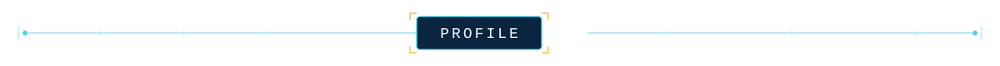
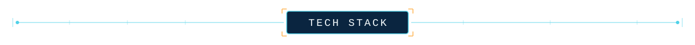
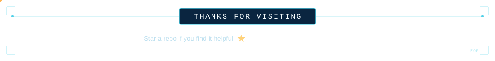

<picture>
  <source media="(prefers-color-scheme: dark)" srcset="./newassets/Header-name2.svg">
  <source media="(prefers-color-scheme: light)" srcset="./header.svg">
  
</picture>

 

 

  

 

I'm a Computer Science student passionate about **Artificial Intelligence and Machine Learning**.

Currently exploring **Deep Learning, Generative AI, LLMs, and Agentic AI** while building practical projects with Python.

I enjoy turning ideas into real-world applications and learning through hands-on development.

 

## Connect With Me

&nbsp;

&nbsp;

&nbsp;

 

---

  

 

<table align="center">
  <tr>
    <td align="center" valign="top" width="50%">
       
      <b>🧠&nbsp; AI & MACHINE LEARNING</b>
        
      
        
      
      
      
      
        
    </td>
    <td align="center" valign="top" width="50%">
       
      <b>🌐&nbsp; WEB DEVELOPMENT</b>
        
      
       
      
        
      
        
    </td>
  </tr>
  <tr>
    <td align="center" valign="top" width="50%">
       
      <b>⚙️&nbsp; BACKEND & APIs</b>
        
      
        
      
        
    </td>
    <td align="center" valign="top" width="50%">
       
      <b>🛠️&nbsp; DEVOPS & TOOLS</b>
        
      
       
      
        
      
      
        
    </td>
  </tr>
</table>

 

---

## GitHub Stats

 

&nbsp;

  

 

---

  
  &nbsp;
  

 

